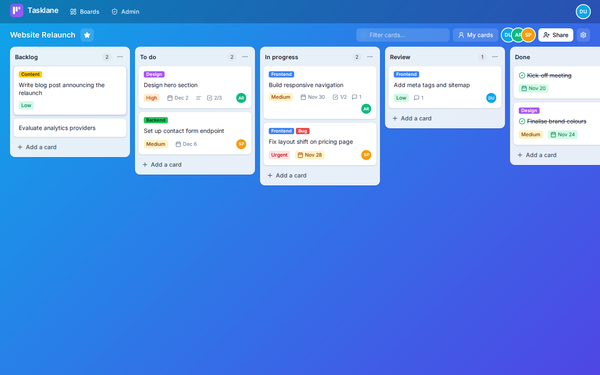
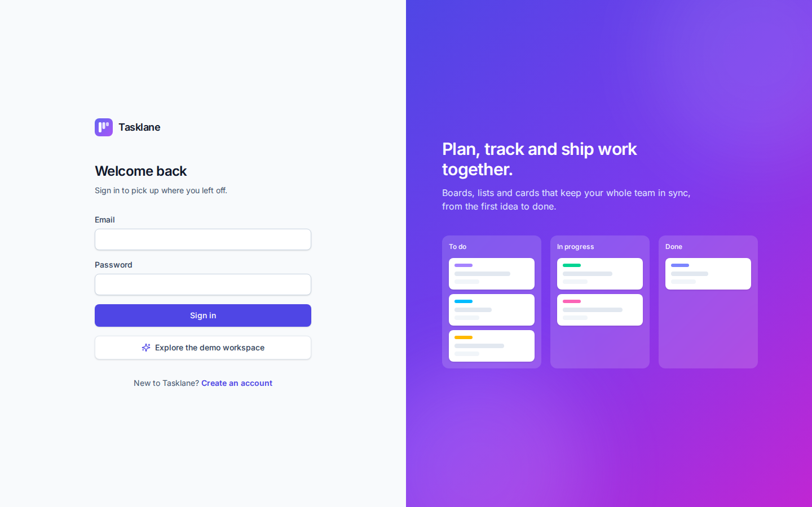
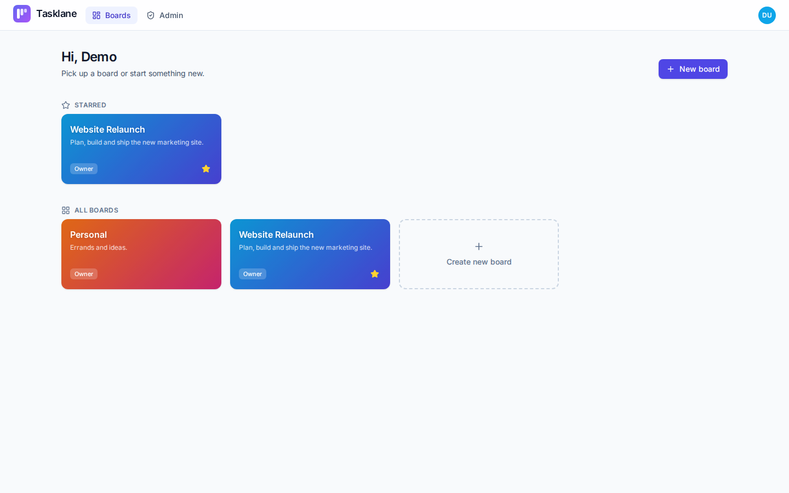
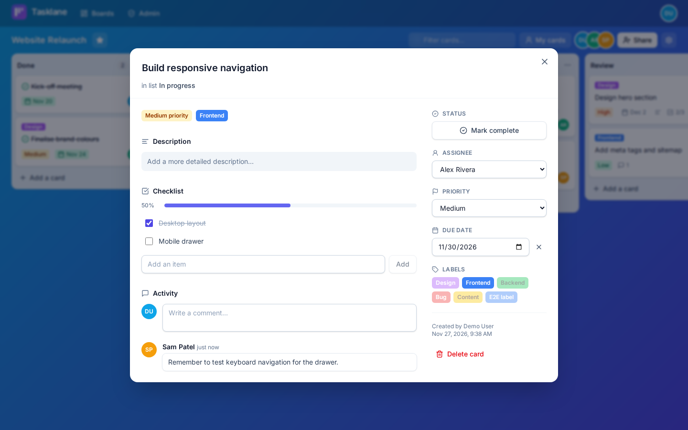
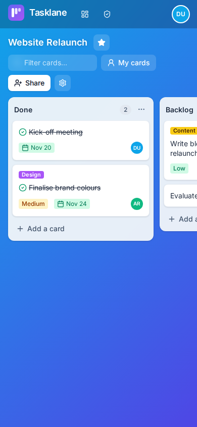

<div align="center">


# Tasklane

**A fast, self-hosted Kanban board for teams.**
Organise work into boards, lists and cards, drag cards between columns, and keep everyone in sync.

[](https://github.com/nevades/project-manager/actions/workflows/ci.yml)


[](LICENSE)



</div>

## Contents

- [Features](#features)
- [Quick start with Docker](#quick-start-with-docker)
- [Configuration](#configuration)
- [Screenshots](#screenshots)
- [Local development](#local-development)
- [Testing](#testing)
- [Documentation](#documentation)
- [Tech stack](#tech-stack)
- [Contributing](#contributing)
- [License](#license)

## Features

- **Boards** with gradient backgrounds, descriptions and stars for quick access
- **Lists and cards** with drag-and-drop reordering using mouse, touch or keyboard
- **Rich cards**: description, priority, due date, assignee, colour labels, checklist with progress and comments
- **Collaboration**: invite members by email; owners manage the board, members manage its content
- **Filtering**: search cards by title or label, or show only the cards assigned to you
- **Administration**: the first account becomes an admin who can change roles and deactivate accounts
- **Secure by default**: BCrypt password hashing, session cookies, CSRF protection and a strict Content Security Policy
- **One-command deploy**: a single Docker image with the web app and API, plus PostgreSQL via Docker Compose

## Quick start with Docker

All you need is [Docker](https://docs.docker.com/get-docker/) (Docker Desktop on Windows and macOS).

```bash
git clone https://github.com/nevades/project-manager.git
cd project-manager
docker compose up --build -d
```

The first build takes a few minutes. Then open **<http://localhost:8080>** and either click
**Explore the demo workspace** or sign in with the demo account:

| Email              | Password   |
| ------------------ | ---------- |
| `demo@example.com` | `demo1234` |

You can also create your own account from the sign-up page.

| Task                          | Command                                  |
| ----------------------------- | ---------------------------------------- |
| View logs                     | `docker compose logs -f app`             |
| Stop                          | `docker compose down`                    |
| Stop and delete all data      | `docker compose down -v`                 |
| Update after `git pull`       | `docker compose up --build -d`           |

> **Port already in use?** Set a different port, e.g. `APP_PORT=9090 docker compose up --build -d`, or put it in a
> `.env` file (see below).

## Configuration

Copy [`.env.example`](.env.example) to `.env` and edit it. Docker Compose reads it automatically.

| Variable                | Default (Compose) | Description                                                  |
| ----------------------- | ----------------- | ------------------------------------------------------------ |
| `APP_PORT`              | `8080`            | Host port for the web app                                    |
| `DB_USERNAME`           | `tasklane`        | Database user                                                |
| `DB_PASSWORD`           | `tasklane`        | Database password – **change this for any real deployment**  |
| `DB_PORT`               | `5432`            | Host port the database is published on                       |
| `DEMO_DATA`             | `true`            | Seed a demo account and sample boards into an empty database |
| `REGISTRATION_ENABLED`  | `true`            | Allow anyone to sign up                                      |
| `SESSION_COOKIE_SECURE` | `false`           | Only send the session cookie over HTTPS                      |

For running in production (HTTPS, backups, hardening) see the [deployment guide](docs/deployment.md).

## Screenshots

| Sign in | Boards |
| :-----: | :----: |
|  |  |
| **Card details** | **Mobile** |
|  |  |

## Local development

Run the API and the frontend dev server separately to get hot reload.

**Prerequisites:** JDK 25, Node.js 22.22+ (24 recommended) and Docker (for PostgreSQL).

```bash
# 1. Start PostgreSQL only
docker compose up -d db

# 2. Start the API on http://localhost:8080 with demo data
cd backend
DEMO_DATA=true ./mvnw spring-boot:run
#   Windows PowerShell:  $env:DEMO_DATA="true"; .\mvnw spring-boot:run

# 3. In a second terminal, start the frontend on http://localhost:5173
cd frontend
npm install
npm run dev
```

Open <http://localhost:5173>. The Vite dev server proxies `/api` to the backend. See the
[development guide](docs/development.md) for the full workflow and project conventions.

## Testing

| Suite                         | Command                                            | What it covers                                 |
| ----------------------------- | -------------------------------------------------- | ---------------------------------------------- |
| Backend unit + integration    | `cd backend && ./mvnw verify`                      | Auth, permissions, board/card API, ordering    |
| Frontend lint, types, unit    | `cd frontend && npm run lint && npm test && npm run build` | Drag-and-drop state logic, type safety |
| End-to-end (real browser)     | `cd e2e && npm ci && npx playwright install chromium && npm test` | Full user journeys against a running stack |

The end-to-end suite expects a fresh stack started with `docker compose up --build -d`. All three suites run in
[GitHub Actions](.github/workflows/ci.yml) on every push and pull request.

## Documentation

| Guide                                      | Contents                                             |
| ------------------------------------------ | ---------------------------------------------------- |
| [Architecture](docs/architecture.md)       | How the pieces fit together, data model, security    |
| [API reference](docs/api.md)               | Every REST endpoint with request and response shapes |
| [Deployment](docs/deployment.md)           | Production setup, HTTPS, backups, upgrades           |
| [Development](docs/development.md)         | Local setup, project layout, conventions             |
| [Contributing](CONTRIBUTING.md)            | Branches, commit messages, pull requests             |
| [Security policy](SECURITY.md)             | How to report a vulnerability                        |
| [Changelog](CHANGELOG.md)                  | Notable changes per release                          |

## Tech stack

| Layer    | Technology                                                                   |
| -------- | ---------------------------------------------------------------------------- |
| Frontend | React 19, TypeScript, Vite, Tailwind CSS 4, TanStack Query, dnd-kit          |
| Backend  | Java 25, Spring Boot 4 (Web MVC, Security, Data JPA, Validation), Flyway     |
| Database | PostgreSQL 17 (H2 in-memory for tests)                                       |
| Tooling  | Maven wrapper, ESLint, Prettier, Vitest, JUnit 5, Playwright, Docker, GitHub Actions |

## Contributing

Contributions are welcome. Please read [CONTRIBUTING.md](CONTRIBUTING.md) first. Commits follow
[Conventional Commits](https://www.conventionalcommits.org/).

## License

Released under the [MIT License](LICENSE).
