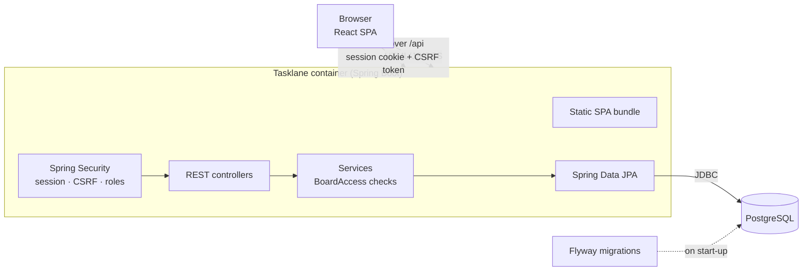
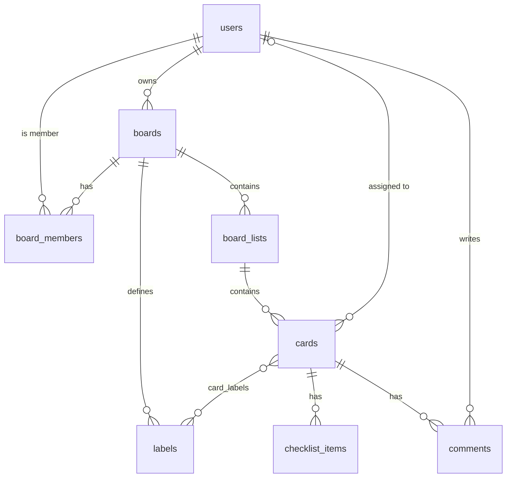

# Architecture

Tasklane is a single deployable unit: a Spring Boot application that serves both the JSON API under `/api` and the
compiled React single-page app. PostgreSQL stores all data.



## Request flow

1. The browser loads `index.html` and the JS bundle from the same origin as the API, so no CORS is involved.
2. On its first state-changing request the SPA calls `GET /api/auth/csrf`, which sets an `XSRF-TOKEN` cookie.
   Every `POST`/`PUT`/`DELETE` echoes it back in the `X-XSRF-TOKEN` header.
3. Signing in creates an HTTP session (`JSESSIONID`, `HttpOnly`, `SameSite=Lax`). The session id is rotated at login
   to prevent session fixation.
4. On every API request `AccountStatusFilter` re-reads the user, so deactivations and role changes made by an admin
   apply immediately to existing sessions.
5. Controllers delegate to services. Every board-scoped operation goes through `BoardAccess`, which returns
   `404 Not Found` to non-members so board ids cannot be probed.
6. Errors are returned as [RFC 9457](https://www.rfc-editor.org/rfc/rfc9457) problem details.

Client-side routes such as `/boards/12` are forwarded to `index.html` by `SpaForwardingController`, so deep links
and page refreshes work.

## Backend layout

```
backend/src/main/java/io/github/nevades/tasklane/
├── board/     Board, BoardMember, BoardList, Label · BoardService · BoardController · BoardAccess
├── card/      Card, ChecklistItem, Comment · CardService · CardController
├── user/      User, Role · AdminUserController
├── security/  SecurityConfig, AuthController, AccountStatusFilter, user details
├── common/    ApiErrors and ApiExceptionHandler (problem details)
└── web/       SpaForwardingController, DemoDataSeeder
```

DTOs are Java records grouped per feature (`BoardDtos`, `CardDtos`, `UserDtos`). Entities are never serialised
directly.

## Data model



- **Ordering.** Lists and cards have an integer `position`. Moves are done server-side in a transaction that
  renumbers the affected lists (`Positioned.moveTo`), so positions are always `0..n-1`.
- **Deletion** cascades in the database (`ON DELETE CASCADE`): deleting a board removes its lists, cards, labels,
  checklist items and comments. Removing a member unassigns their cards on that board.
- **Schema changes** are versioned Flyway migrations in `backend/src/main/resources/db/migration`. Hibernate only
  validates the schema (`ddl-auto: validate`); it never changes it.

## Roles and permissions

| Action                                     | Admin | Board owner | Board member | Other users |
| ------------------------------------------ | :---: | :---------: | :----------: | :---------: |
| Manage user roles / deactivate accounts    |  ✅   |             |              |             |
| Rename, re-colour or delete a board        |       |     ✅      |              |             |
| Add or remove board members                |       |     ✅      | leave only   |             |
| Create/edit lists, cards, labels, comments |       |     ✅      |      ✅      |             |
| Delete a comment                           |       |  own only   |   own only   |             |
| See the board at all                       |       |     ✅      |      ✅      |             |

Admins have no implicit access to other people's boards.

## Frontend

```
frontend/src/
├── lib/          api.ts (fetch + CSRF), queries.ts (TanStack Query hooks), types, board-state (DnD logic), theme
├── components/   Header, Modal, Avatar, Logo, ConfirmDialog, Spinner
└── features/     auth · boards · board (Kanban + settings) · card (details modal) · admin
```

- **Server state** lives in TanStack Query. Mutations update the cache optimistically where latency would be
  noticeable (moving cards, ticking checklist items, editing card fields) and then re-sync with the server.
- **Card edits** for the same card are serialised (mutation `scope`) and always send the latest full card state, so
  quick successive edits can never overwrite each other.
- **Drag and drop** uses dnd-kit. The pure functions in `lib/board-state.ts` hold the list/card reordering logic and
  are unit tested.
- **Routing** uses React Router. The open card is part of the URL (`/boards/1?card=42`), so cards can be linked.
